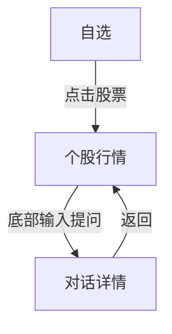
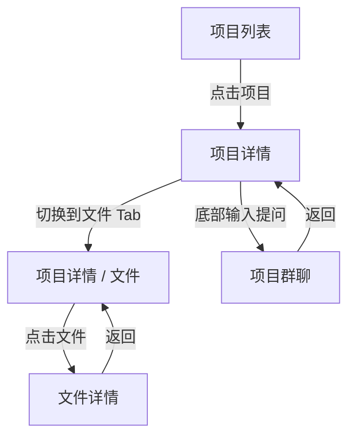
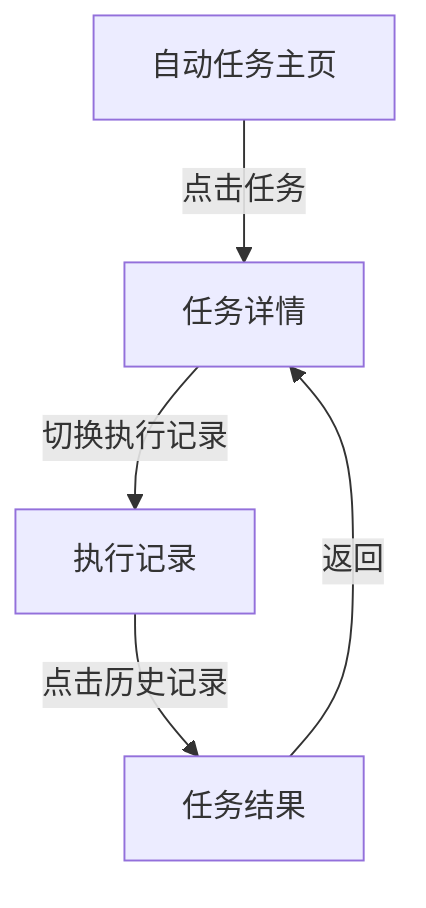

# Wind Alice 移动端 Demo 需求说明文档

本文档用于帮助产品经理按照当前移动端 Demo 的框架提交模块内容。提交重点是产品结构、页面层级、Panel 目录、内容对象和交互闭环，不需要设计页面样式。

当前 Demo 的唯一入口：

- `../prototype/index.html`

## 1. 使用原则

产品经理提交内容时，只描述三件事：

1. 用户看到什么对象。
2. 用户可以执行什么操作。
3. 用户点击后进入哪个页面。

不需要提交：

- 颜色、字号、圆角、阴影。
- 卡片具体视觉样式。
- 顶部导航栏和底部 TabBar 的 UI 细节。
- HTML 或 CSS。

所有模块统一套用当前 Demo 的移动端标准组件：

- 顶部导航栏。
- 左侧 `=` Panel 抽屉。
- 内容卡片。
- 底部输入框。
- 底部 TabBar。

### 1.1 单一移动端原则

当前 Demo 固定使用 375 × 812 移动端手机画布。产品经理提交页面结构时，只需描述移动端单列布局、Panel 抽屉、底部输入框和底部 TabBar 行为。

## 2. 模块定义

当前 Demo 的一级模块如下：

| 模块 | 当前名称 | 模块类型 | 模块职责 | 是否可作为底部 Tab |
| --- | --- | --- | --- | --- |
| 市场 | 市场 | 市场型 | 自选、热议、市场行情、持仓的高频入口 | 是 |
| 私人助理 | 私人助理 | 对话型 | 管理 Alice / 专家对话与历史会话 | 是 |
| 协同工作 | 协同工作 | 协作型 | 管理项目、项目动态、群聊和项目文件 | 是 |
| 拓客服务 | 拓客服务 | 服务型 | 管理拓客服务、客户触达和服务记录 | 是 |
| 会议 | 会议 | 对象管理型 | 管理会议、纪要和待办 | 是，可放入“我的”瓷片区 |
| 文件资料 | 文件资料 | 对象管理型 | 管理文件夹、文件、上传资料和文件详情 | 是，可放入“我的”瓷片区 |
| 自动任务 | 自动任务 | 对象管理型 | 管理定时任务、提醒任务、执行记录和执行结果 | 是，可放入“我的”瓷片区 |
| 工具市场 | 工具市场 | 能力市场型 | 管理技能、专家和连接器 | 是，可放入“我的”瓷片区 |
| 我的 | 我的 | 个人中心型 | 管理账号信息、积分、设置和未放入底部 Tab 的模块入口 | 固定存在 |

底部 TabBar 规则：

```text
| Tab 1 | Tab 2 | Tab 3 | Tab 4 | 我的 |
```

前 4 个 Tab 可由用户配置。未选入底部 Tab 的模块进入“我的”的瓷片区。

## 3. 页面层级

当前 Demo 使用四级页面层级：

| 层级 | 用途 | 默认输入框 | 默认 TabBar | 示例 |
| --- | --- | --- | --- | --- |
| 一级 | 模块首页、频道页、对象列表页 | 有 | 有 | 自选、私人助理、项目列表、文件资料主页、自动任务主页、工具市场主页 |
| 二级 | 模块内对象详情页，通常带子 Tab | 有 | 有 | 项目详情、任务详情 |
| 三级 | 具体对象详情页或结果页 | 有 | 有 | 项目群聊、文件详情、通知中心、个股行情、任务结果 |
| 四级 | 设置、搜索、编辑、授权、配置类页面 | 无 | 按流程配置 | 设置、工具市场搜索、菜单编辑 |

说明：

- 一级、二级、三级页面默认保留输入框，方便用户基于当前页面上下文向 Alice 发起对话。
- 四级页面默认不保留输入框；TabBar 必须按流程明确配置。设置、搜索页可保留，菜单编辑、授权等聚焦型流程隐藏。
- 如某个三级页面需要全屏预览，可以申请隐藏 TabBar，但需要在需求中明确说明原因。

## 4. 顶部导航栏类型

产品经理只需要选择导航栏类型，不需要自行设计导航栏。

### 1-A 一级频道型

适合有多个同级频道的一级页面。

```text
| 页面A | 页面B | 页面C | 页面D |          | 功能 | 功能 |
```

当前示例：

```text
市场
| 自选 | 热议 | 市场 | 持仓 |          | 搜索 | 通知 |

我的
| 我的 |                         | 设置 | 通知 |
```

核心功能：

- 顶部左侧是同模块内高频频道。
- 右侧放模块级功能，例如搜索、设置、通知。
- 不使用 `=` Panel，除非该模块确实需要对象目录。

### 1-B-1 一级对话主页型

适合私人助理未开始对话的首页。

```text
| = | Alice | > |                  | 语音 | 新建对话 | 通知 |
```

核心功能：

- `=` 打开对话 Panel。
- `Alice >` 支持切换 Alice、Agent 或专家数字分身。
- 新建对话是模块级主操作。

### 1-B-2 一级对象列表型

适合项目列表、文件资料主页这类对象列表页。

```text
| = | 页面名称 |                 | 功能 | 功能 | 通知 |
```

当前示例：

```text
协同工作
| = | 项目列表 |                 | 新建对话 | 通知 |

文件资料
| = | 文件夹 |                   | 上传文件 | 新建文件夹 | 更多 |

会议
| = | 平台会议 / 我的日程 / 我的纪要 / 我的收藏 | 通知 |
```

核心功能：

- `=` 打开当前模块的对象 Panel。
- 页面内容区展示对象列表。
- 右侧功能是列表级操作。

### 1-C1 一级对话详情型

适合私人助理已开始对话后的对话详情。

```text
| = | 对话标题 |                | 语音 | 新建对话 | 通知 |
```

核心功能：

- `=` 仍然打开对话 Panel。
- 标题显示当前对话。
- 输入框绑定当前对话上下文。

### 1-D 一级带子 Tab 型

适合一级模块首页中需要二级内容切换的页面。

```text
| = | 页面名称 |                | 功能 | 通知 |
| 子 Tab | 子 Tab | 子 Tab |
```

当前示例：

```text
自动任务
| = | 自动任务 |                | 新建任务 | 通知 |
| 定时任务 | 提醒任务 |

工具市场
| = | 工具市场 |                | 搜索 | 通知 |
| 技能 | 专家 | 连接器 |
```

核心功能：

- 顶部第一行定义模块级操作。
- 第二行子 Tab 切换当前页面内容域。
- `=` 打开模块对象目录。

### 2-A-1 二级对象详情型

适合项目详情、任务详情。

```text
| = | 对象名称 | > |              | 功能 | 通知 |
| 子 Tab | 子 Tab | 子 Tab |
```

当前示例：

```text
项目详情
| = | 项目名称 | > |              | 新建项目 | 通知 |
| 动态 | 群聊 | 文件 |

任务详情
| = | 每日市场早报 | > |          | 立即执行 | 通知 |
| 任务说明 | 执行记录 |
```

核心功能：

- `=` 打开当前模块 Panel。
- `>` 表示可快速切换当前对象，例如切换项目。
- 子 Tab 切换对象详情中的内容域。

### 3-A 三级详情型

适合具体对象详情、结果详情、通知中心、个股行情。

```text
| < | 页面名称 |                 | 功能 | 功能 |
```

当前示例：

```text
项目群聊
| < | 对话标题 |                 | 语音 | 新建对话 | 通知 |

项目文件
| < | 文件标题 |                 | 加入对话 | 分享 | 更多 |

个股行情
| < | 股票名称 [代码] |           | 收藏 | 搜索 |

任务结果
| < | 执行时间 - 任务名称 |      | 再次执行 | 通知 |

通知中心
| < | 通知中心 |               | 设置 |
```

核心功能：

- `<` 返回上一级页面。
- 页面标题必须明确当前对象。
- 右侧功能是对象级操作。

### 3-B 三级带子 Tab 型

适合从“我的”瓷片区进入，但本身仍有多个子分类的页面。

```text
| < | 页面名称 |                 | 功能 | 功能 |
| 子 Tab | 子 Tab | 子 Tab |
```

当前示例：

```text
工具
| < | 工具 |                     | 搜索 |
| 技能 | 专家 | 连接器 |

自动任务
| < | 自动任务 |                 | 搜索 | 新建 |
| 定时任务 | 提醒任务 |
```

核心功能：

- 从“我的”进入时，底部 TabBar 仍高亮“我的”。
- 顶部导航栏表达当前模块页面。
- 子 Tab 只切换当前页面内容域。

### 4-A 四级设置/编辑型

适合设置、菜单编辑、授权配置等流程。

```text
| < | 页面名称 |
```

当前示例：

```text
菜单编辑
| < | 菜单编辑 |
```

核心功能：

- 用于配置流程。
- 默认无输入框。
- TabBar 按流程配置：普通设置页可保留，菜单编辑、授权等聚焦型流程隐藏。

### 4-B 四级搜索型

适合模块内需要独立承载搜索词、搜索标的和结果列表的页面。

```text
| < | 搜索词、搜索标的 | x | 搜索 |
```

当前示例：

```text
工具市场搜索
| < | 搜索词、搜索标的 | x | 搜索 |
```

核心功能：

- 中间是可输入搜索框。
- `x` 用于清空当前搜索词。
- 右侧“搜索”用于提交当前搜索。
- 初始状态不展示全部工具，等待用户输入搜索词。
- 回车或点击“搜索”提交后，结果区顶部展示 `全部 / 专家 / 技能 / 连接器` Tab。
- 每个结果 Tab 需要标号显示当前搜索词下的匹配数量。
- 默认无底部输入框，TabBar 保持来源模块配置。

## 5. 当前 Demo 页面目录

| 模块 | 页面 | 路径 | 层级 | 导航栏 | 输入框 | TabBar |
| --- | --- | --- | --- | --- | --- | --- |
| 市场 | 自选 | 市场 > 自选 | 一级 | 1-A | 默认有 | 有 |
| 市场 | 热议 | 市场 > 热议 | 一级 | 1-A | 默认有 | 有 |
| 市场 | 市场 | 市场 > 市场 | 一级 | 1-A | 默认有 | 有 |
| 市场 | 持仓 | 市场 > 持仓 | 一级 | 1-A | 默认有 | 有 |
| 市场 | 个股行情 | 市场 > 自选 > 个股行情 | 三级 | 3-A | 默认有 | 有 |
| 私人助理 | 私人助理主页 | 私人助理 | 一级 | 1-B-1 | 有 | 有 |
| 私人助理 | 对话详情 | 私人助理 > 对话详情 | 一级 | 1-C1 | 有 | 有 |
| 协同工作 | 项目列表 | 协同工作 > 项目列表 | 一级 | 1-B-2 | 默认有 | 有 |
| 协同工作 | 项目详情 | 协同工作 > 项目列表 > 项目详情 | 二级 | 2-A-1 | 默认有 | 有 |
| 协同工作 | 项目群聊 | 协同工作 > 项目详情 > 项目群聊 | 三级 | 3-A | 有 | 有 |
| 拓客服务 | 拓客服务主页 | 拓客服务 | 一级 | 1-A | 默认有 | 有 |
| 会议 | 我的参会 | 会议 > 我的参会 | 一级 | 1-D | 默认有 | 有 |
| 会议 | 全部会议 | 会议 > 全部会议 | 一级 | 1-D | 默认有 | 有 |
| 会议 | 录音上传 | 会议 > 录音上传 | 一级 | 1-D | 默认有 | 有 |
| 会议 | 会议详情 | 会议 > 来源主页面 > 会议详情 | 三级 | 3-A | 有 | 有 |
| 文件资料 | 文件资料主页 | 文件资料 > 文件夹 | 一级 | 1-B-2 | 默认有 | 有 |
| 文件资料 | 文件详情 | 文件资料 > 文件夹 > 文件详情 | 三级 | 3-A | 有 | 有 |
| 自动任务 | 自动任务主页 | 自动任务 | 一级 | 1-D | 默认有 | 有 |
| 自动任务 | 任务详情 | 自动任务 > 任务详情 | 二级 | 2-A-1 | 默认有 | 有 |
| 自动任务 | 任务结果 | 自动任务 > 任务详情 > 执行记录 > 任务结果 | 三级 | 3-A | 有 | 有 |
| 工具市场 | 工具市场主页 | 工具市场 | 一级 | 1-D | 默认有 | 有 |
| 工具市场 | 工具市场搜索 | 工具市场 > 搜索 | 四级 | 4-B | 无 | 有（来源模块） |
| 我的 | 我的 | 我的 | 一级 | 1-A | 默认有 | 有 |
| 我的 | 设置 | 我的 > 设置 | 四级 | 4-A | 无 | 有 |
| 我的 | 菜单编辑 | 我的 > 编辑瓷片区 > 菜单编辑 | 四级 | 4-A | 无 | 无 |
| 其他 | 通知中心 | 任意页面 > 通知中心 | 三级 | 3-A | 默认有 | 有 |

## 6. Panel 目录

Panel 是 `=` 打开的左侧目录。Panel 不是页面内容区，它只负责当前模块的对象目录、分组和模块级操作。

Panel 统一结构：

```text
Panel 名称
+ 顶部操作

分组 / 抽屉头
- 对象
- 对象
```

### Panel 对象长按 / 右键操作规范

适用范围：

- 仅用于 Panel 中可被用户管理的业务对象，不用于页面入口、筛选范围或功能导航。
- 移动端长按对象 550ms 唤起；Web 端右键唤起；键盘使用 `Shift + F10` 或菜单键唤起。
- 手指移动超过 8px 时取消长按识别，避免用户滚动 Panel 时误触；长按成功后不再执行该对象原本的点击跳转。

菜单样式与关闭方式：

- 操作菜单位于 Panel 底部，距左右与底部 12px，圆角 16px；蒙层只覆盖 Panel，不关闭 Panel。
- 顶部显示对象类型与完整名称；操作采用“图标 + 文案”纵向排列，单项高度 40px。
- 点击蒙层、点击“取消”或按 `Esc` 关闭；关闭后焦点回到原对象。
- 普通操作使用中性色；删除等不可逆操作使用红色，并必须经过二次确认。
- 重新命名在原菜单内进入输入态；确认后立即更新 Panel 名称。置顶 / 取消置顶点击后立即生效，并将对象稳定排序到当前分组顶部。

各模块操作矩阵：

| 模块对象 | 更多操作 | 说明 |
|---|---|---|
| 私人助理 · 历史对话 | 重新命名、置顶 / 取消置顶、删除对话 | 收藏分组与最近分组内分别保持置顶排序 |
| 协同工作 · 项目 | 重新命名、置顶 / 取消置顶、删除项目 | 删除项目前二次确认；项目删除后其群聊一并从 Panel 隐藏 |
| 协同工作 · 群聊 | 重新命名、置顶 / 取消置顶、删除群聊 | 置顶仅在所属项目内生效 |
| 会议 · 会议分类 | 置顶 / 取消置顶 | 平台分类由系统维护，不允许重命名或删除 |
| 会议 · 即将开始 / 最近纪要 | 收藏 / 取消收藏 | 会议记录不提供重命名与置顶 |
| 文件资料 · 文件夹 | 重新命名、置顶 / 取消置顶、删除文件夹 | 删除前二次确认 |
| 自动任务 · 任务 | 重新命名、置顶 / 取消置顶、启用 / 停用、删除任务 | 运行状态直接显示在对象行内 |
| 工具市场、我的、我的参会入口 | 无 | 属于范围或页面导航，不是用户管理对象 |

### 私人助理 Panel

适用页面：

- 私人助理主页。
- 对话详情。

```text
Chat
+ 新建对话

收藏对话
- 茅台近5年ROE变化分析
- 半导体板块异动原因

最近对话
- A股消费因子回测
- 新能源车渗透率研报
- 公募Q3持仓对比
- 信用债评级筛查
```

规则：

- 对象类型是历史对话。
- 点击对象进入对话详情。
- 对话详情继续保留 Panel，方便切换历史对话。

### 协同工作 Panel

适用页面：

- 项目列表。
- 项目详情。

```text
项目
+ 新建项目

信用债合规筛查
- 任务启动讨论
- 数据验证与核对
- 优先级调整确认

Q3持仓归因分析
- 归因口径确认
- 行情数据拉取

A股消费因子回测
- 回测结果讨论
- 报告生成

半导体板块舆情汇总
- 素材收集
- 摘要确认
```

规则：

- 抽屉头是项目。
- 对象是项目下的群聊对话。
- 点击项目名进入项目详情。
- 点击群聊进入项目群聊。
- 项目列表不使用标题右侧 `>` 切换项目；项目详情可使用 `>` 快速切换项目。

### 会议 Panel

适用页面：

- 我的参会。
- 全部会议。
- 录音上传。
- 会议详情。

```text
会议
+ AI听会 / + 录音上传

我的参会
- 我的会议
- 已预约会议
- 已收藏会议
- AI听会

全部会议
- 会议状态
- 热门主题
- 会议类型
- 行业分类

录音上传
- 已上传录音
```

规则：

- 进入会议模块默认打开“我的参会”；我的参会、全部会议、录音上传均为无返回按钮的主页面。
- Panel 顶部操作随当前主页面变化：我的参会和全部会议为 `+ AI听会`，录音上传为 `+ 录音上传`。
- 我的参会按我的会议、已预约会议、已收藏会议、AI听会组织；全部会议按状态、主题、类型、行业筛选；录音上传直接列出上传对象。
- 主页面支持会议列表与日历两种展示方式；列表支持全部、今日、近三天和自定义时间范围。
- 日历按月展示会议，点击日期回到对应日期的列表；年份入口可切换月份。
- 会议卡片显示标题、时间、状态和星标；可预约会议的星标动作表示预约，其余会议表示收藏。
- 会议详情是会议模块中唯一具有返回功能的页面，返回到进入详情前的来源主页面。
- 详情使用“返回 / 会议纪要 / 录音转记 / 音/视频观看 / 边际变化”子导航。
- 详情顶部操作包括搜索、复制、下载、星标和添加到文件夹。
- 所有会议页面的底部输入入口打开会议小助手，支持生成会议纪要、提炼边际变化、形成会后待办和准备参会问题。

### 会议详情类型

会议详情统一以当前会议对象为上下文，来源可以是平台会议、AI听会、网络资源或录音上传。状态标签包括可预约、直播中、回放和文件；状态影响收藏/预约语义以及音视频呈现，但不改变详情的五个内容分区。

### 文件资料 Panel

适用页面：

- 文件资料主页。

```text
文件夹
+ 新建文件夹

常用文件夹
- 信用债合规资料
- 市场热议素材库
- 客户路演资料
```

规则：

- 对象类型是文件夹、文件。
- 文件资料主页内容区使用 Card 展示文件夹和文件。
- 点击文件或文件夹进入对应详情。

### 自动任务 Panel

适用页面：

- 自动任务主页。
- 任务详情。

```text
自动任务
+ 新建任务

定时任务
- 每日持仓更新 & 3W3C 工作计划
- 每周市场解读周报
- 每日市场早报汇总

提醒任务
- 有研新材
- 双环传动
- 上证指数
```

规则：

- 对象类型是任务。
- 点击任务进入任务详情。
- 任务详情中通过子 Tab 查看任务说明和执行记录。
- 点击执行记录 Card 进入任务结果页。

### 工具市场 Panel

适用页面：

- 工具市场主页。

```text
工具市场

技能
- 我的技能
- 官方推荐

专家
- 我的专家
- 官方推荐

连接器
- 我的连接器
- 官方推荐
```

规则：

- 顶部 Tab 决定对象类型：技能、专家、连接器。
- Panel 条目决定对象范围：我的、官方推荐。
- 内容区统一使用 Card。

### 我的 Panel

适用页面：

- 我的。

```text
功能
- 会议
- 文件资料
- 自动任务
- 工具市场
- 充值/加油包
- 记忆管理
- 微信Claw Bot
- API密钥
```

规则：

- 未加入底部 Tab 的模块，以瓷片形式出现在“我的”页面。
- 从“我的”瓷片进入模块时，顶部导航栏使用该模块自己的导航栏，底部 TabBar 高亮“我的”。

## 7. 内容对象

每个页面需要明确内容对象。页面内容只承载对象展示和对象操作，不承担全局导航职责。

| 页面 | 内容对象 | 推荐展示方式 | 点击后进入 |
| --- | --- | --- | --- |
| 自选 | 股票 | 行情列表 / 迷你走势图 | 个股行情 |
| 热议 | 热议话题 | 话题 Card | 话题详情或对话 |
| 市场 | 指数、板块、热门板块 | 指数横排 Card、热力图、板块列表 | 板块详情或个股行情 |
| 持仓 | 持仓证券 | 持仓列表 Card | 个股行情 |
| 私人助理主页 | 推荐问题、历史对话 | 对话入口 Card | 对话详情 |
| 对话详情 | 消息 | 聊天气泡 | 当前对话内继续 |
| 项目列表 | 项目 | 项目 Card | 项目详情 |
| 项目详情 | 动态、群聊、文件 | 子 Tab + Card | 项目群聊、文件详情 |
| 文件资料主页 | 文件夹、文件 | 文件 Card | 文件详情 |
| 自动任务主页 | 定时任务、提醒任务 | 任务 Card | 任务详情 |
| 任务详情 | 任务说明、执行记录 | 表单 + 执行记录 Card | 任务结果 |
| 任务结果 | 单次执行结果 | 聊天式结果 Card | 当前结果上下文对话 |
| 工具市场主页 | 技能、专家、连接器 | 工具市场 Card | 工具详情或配置 |
| 我的 | 个人信息、瓷片、账号功能 | 个人中心 Card + 瓷片 | 对应模块或设置页 |
| 菜单编辑 | 模块排序 | 拖拽列表 | 保存后回到我的 |
| 通知中心 | 通知 | 通知列表 Card | 对应页面 |

## 8. 底部输入框规则

底部输入框是 Alice 的上下文入口，不只是聊天输入框。

判断一个页面是否需要输入框时，回答以下问题：

1. 用户是否可能基于当前页面向 Alice 提问？
2. 当前页面是否有可被 Alice 理解的上下文？
3. 发起对话后，是否需要能返回当前页面？
4. 输入内容是否绑定当前项目、文件、任务、证券或对话？

默认规则：

| 页面层级 | 是否显示输入框 | 说明 |
| --- | --- | --- |
| 一级 | 是 | 面向当前模块或当前页面 |
| 二级 | 是 | 面向当前对象，例如项目、任务 |
| 三级 | 是 | 面向当前具体对象或结果 |
| 四级 | 否 | 设置、编辑、授权类流程不显示 |

输入框上下文示例：

| 页面 | 输入框上下文 | 发起对话后的返回 |
| --- | --- | --- |
| 自选 | 当前自选股列表 | 返回自选 |
| 个股行情 | 当前证券 | 返回个股行情 |
| 项目列表 | 协同工作模块 | 返回项目列表 |
| 项目详情 | 当前项目 | 返回项目详情 |
| 项目群聊 | 当前项目群聊 | 返回项目群聊 |
| 文件详情 | 当前文件 | 返回文件详情 |
| 任务详情 | 当前任务 | 返回任务详情 |
| 任务结果 | 当前执行结果 | 返回任务结果 |
| 工具市场 | 当前工具类型或工具对象 | 返回工具市场 |
| 我的 | 当前账号和个人中心上下文 | 返回我的 |

## 9. 底部 TabBar 规则

底部 TabBar 是一级模块入口，不表达页面层级。

默认规则：

| 页面层级 | 是否显示 TabBar | 说明 |
| --- | --- | --- |
| 一级 | 是 | 模块入口必须保留 |
| 二级 | 是 | 用户仍可快速切换主模块 |
| 三级 | 是 | 保持移动端主导航稳定 |
| 四级 | 按流程配置 | 设置、搜索页可保留；菜单编辑、授权等聚焦型流程隐藏 |

高亮规则：

| 来源 | TabBar 高亮 |
| --- | --- |
| 从市场进入个股行情 | 市场 |
| 从私人助理进入对话详情 | 私人助理 |
| 从协同工作进入项目详情或项目群聊 | 协同工作 |
| 从“我的”瓷片进入会议、文件资料、自动任务、工具市场 | 我的 |
| 从任意页面进入通知中心 | 保持来源模块，当前 Demo 可统一高亮我的 |
| 从菜单编辑进入四级页 | 不显示 TabBar |

## 10. FlowChart 与上下文闭环

每个模块都应提供独立 FlowChart。FlowChart 用于说明页面之间如何跳转、底部输入框如何进入对话、返回时回到哪里，以及 TabBar 高亮哪个模块。

FlowChart 不改变页面布局，它用于需求确认和 Demo 右侧状态栏展示。

### 10.1 FlowChart 类型

| 类型 | 说明 | 是否必填 |
| --- | --- | --- |
| 模块页面 Flow | 描述模块内部页面跳转，例如列表 > 详情 > 结果 | 必填 |
| 输入框对话 Flow | 描述从底部输入框发起问题后进入哪里、返回哪里 | 必填 |
| 跨模块 Flow | 描述从通知、我的瓷片、文件引用等入口进入其他模块 | 需要时填写 |

### 10.2 当前 Demo Flow 示例

市场：



协同工作：



自动任务：



### 10.3 Flow 返回规则表

| 当前页面 | 触发动作 | 进入页面 | 返回页面 | 上下文对象 | TabBar 高亮 |
| --- | --- | --- | --- | --- | --- |
| 个股行情 | 底部输入提问 | 对话详情 | 个股行情 | 当前证券 | 市场 |
| 项目列表 | 底部输入提问 | 对话详情 / 新建项目对话 | 项目列表 | 协同工作模块 | 协同工作 |
| 项目详情 | 底部输入提问 | 项目群聊 | 项目详情 | 当前项目 | 协同工作 |
| 项目详情 / 文件 | 点击文件 | 文件详情 | 项目详情 / 文件 | 当前项目 + 当前文件 | 协同工作 |
| 任务详情 / 执行记录 | 点击执行记录 | 任务结果 | 任务详情 | 当前任务 + 单次执行结果 | 我的 |
| 文件详情 | 底部输入提问 | 对话详情 | 文件详情 | 当前文件 | 我的 |

### 10.4 Demo 右侧状态栏呈现

当前 Demo 在右侧状态栏展示当前页面所属模块的 Flow：

```text
模块 Flow
- Flow 名称
- 页面节点
- 上下文
- TabBar 高亮
```

页面节点应可点击，点击后切换到对应页面。带子 Tab 的节点需要同时切换页面和子 Tab，例如：

```text
项目详情 / 文件 -> work-detail + files Tab
任务详情 / 执行记录 -> automation-task-detail + records Tab
```

## 11. 交互闭环

提交新模块时，必须写清楚点击关系。

当前 Demo 的主要闭环：

| 起点 | 用户操作 | 终点 |
| --- | --- | --- |
| 私人助理主页 | 点击历史对话 | 对话详情 |
| 项目列表 | 点击项目 Card | 项目详情 |
| 项目详情 | 点击群聊 Card | 项目群聊 |
| 项目详情 | 点击项目名 `>` | 快速切换项目 |
| 项目列表 / 项目详情 | 点击 `=` | 项目 Panel |
| 文件资料主页 | 点击文件 Card | 文件详情 |
| 自动任务主页 | 点击任务 Card | 任务详情 |
| 任务详情 | 点击执行记录 Card | 任务结果 |
| 我的 | 点击编辑瓷片区 | 菜单编辑 |
| 市场自选 | 点击股票 | 个股行情 |
| 任意页面 | 点击通知 | 通知中心 |

## 12. 产品经理提交模板

产品经理提交模块时，建议复制以下模板。

```markdown
# 模块接入需求

## 1. 模块定义

| 项 | 内容 |
| --- | --- |
| 模块名称 |  |
| 模块类型 | 市场型 / 对话型 / 协作型 / 对象管理型 / 能力市场型 / 服务型 / 个人中心型 |
| 模块职责 |  |
| 是否可作为底部 Tab | 是 / 否 |
| 如果不在底部 Tab，放入“我的”的瓷片名称 |  |

## 2. 页面目录

| 页面名称 | 层级 | 路径 | 导航栏类型 | 是否有输入框 | 是否有 TabBar |
| --- | --- | --- | --- | --- | --- |
|  | 一级 / 二级 / 三级 / 四级 |  |  | 是 / 否 | 是 / 否 |

## 3. 顶部导航栏

| 页面名称 | 导航栏类型 | 左侧功能 | 页面标题 / 频道 | 右侧功能 | 子 Tab |
| --- | --- | --- | --- | --- | --- |
|  |  |  |  |  |  |

## 4. Panel 目录

| 页面名称 | 是否有 Panel | Panel 名称 | 顶部操作 | 分组 / 抽屉头 | 对象类型 | 点击后进入 |
| --- | --- | --- | --- | --- | --- | --- |
|  | 是 / 否 |  |  |  |  |  |

Panel 草稿：

```text
Panel 名称
+ 顶部操作

分组
- 对象
- 对象
```

## 5. 页面内容对象

| 页面名称 | 内容对象 | 卡片字段 | 点击后进入 |
| --- | --- | --- | --- |
|  |  |  |  |

## 6. 输入框上下文

| 页面名称 | 输入框绑定对象 | 发起对话后返回页面 |
| --- | --- | --- |
|  |  |  |

## 7. FlowChart 与返回规则

### 模块页面 Flow

```mermaid
flowchart TD
```

### 输入框对话 Flow

```mermaid
flowchart TD
```

### 返回规则

| 当前页面 | 触发动作 | 进入页面 | 返回页面 | 上下文对象 | TabBar 高亮 |
| --- | --- | --- | --- | --- | --- |
|  |  |  |  |  |  |

## 8. 交互闭环

| 起点 | 用户操作 | 终点 | 说明 |
| --- | --- | --- | --- |
|  |  |  |  |

## 9. Mock 数据

```text
对象名称：
状态：
说明：
标签：
点击后页面：
```
```

## 13. 审核清单

产品经理提交后，按以下清单检查：

| 检查项 | 是否通过 |
| --- | --- |
| 模块职责清楚，没有和其他模块混淆 |  |
| 页面层级完整，路径能走通 |  |
| 每个页面都选择了导航栏类型 |  |
| 使用 `=` 的页面都写清楚 Panel 目录 |  |
| Panel 只放目录、对象和模块级操作 |  |
| 内容区只放当前页面对象，不承担导航职责 |  |
| 输入框上下文清楚 |  |
| TabBar 显示和高亮规则清楚 |  |
| 已提供模块页面 Flow 和输入框对话 Flow |  |
| Flow 节点、返回页面和上下文对象清楚 |  |
| 点击闭环完整 |  |
| Mock 数据足够支撑 Demo 展示 |  |
